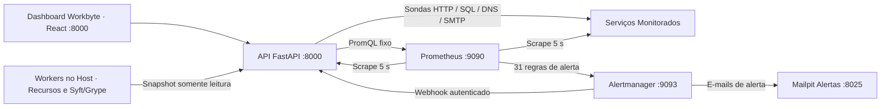

# AulaRedes — Plataforma de Monitoramento DevOps

Plataforma completa de observabilidade, segurança e simulação controlada de falhas/ataques para serviços de rede (**HTTP**, **PostgreSQL**, **DNS** e **SMTP**), desenvolvida para a disciplina de **Redes de Computadores e Internet (IDP)**.

> Toda métrica exibida provém de sondas reais, exportadores nativos e cargas controladas — valores ausentes ou expirados aparecem como **Sem dados (`—`)**, nunca como zero saudável falsificado.

---

## Sumário

- [Arquitetura e Serviços](#arquitetura-e-serviços)
- [Funcionalidades da Plataforma](#funcionalidades-da-plataforma)
- [Como Executar a Aplicação](#como-executar-a-aplicação)
- [Como Usar e Demonstrar na Prática](#como-usar-e-demonstrar-na-prática)
- [Como Realizar os Testes e Verificações](#como-realizar-os-testes-e-verificações)
- [Documentação Completa](#documentação-completa)
- [Limites do Ambiente Acadêmico](#limites-do-ambiente-acadêmico)

---

## Arquitetura e Serviços



### Interfaces e Portas Locais (`127.0.0.1`)

| Componente | Endereço | Descrição |
|---|---|---|
| **Dashboard Workbyte** | http://localhost:8000 | Landing pública → login → painel consolidado, serviços, segurança, incidentes, `#lab` e `#attacks` |
| **Documentação da API** | http://localhost:8000/docs | Swagger UI da API FastAPI (protegido por sessão) |
| **Workbyte Store (E-commerce 8-bit)** | http://localhost:8011 | Loja virtual gamer monitorada integrada ao PostgreSQL e ao SMTP local (sem painel de ataques) |
| **Endpoint HTTP Monitorado** | http://localhost:8011/work | Alvo principal das sondas de disponibilidade, RPS, latência e conexões |
| **Mailpit — E-mails de Alerta** | http://localhost:8025 | Caixa local independente onde chegam alertas `Atenção`, `Crítico` e recuperações |
| **Mailpit — Caixa SMTP Monitorada** | http://localhost:8026 | Receptor final das mensagens entregues pelo servidor SMTP do laboratório |
| **Prometheus** | http://localhost:9090 | Armazenamento de séries temporais (7 dias) e avaliação das 31 regras |
| **Alertmanager** | http://localhost:9093 | Deduplicação, agrupamento e despacho de notificações por e-mail e webhook |

---

## Funcionalidades da Plataforma

### 1. Monitoramento dos 4 Serviços de Rede
- **Web Server HTTP (`#service`):** disponibilidade (`GET /health`), requisições por segundo (RPS), latência da sonda e p95 (`/work` e rotas da loja `/api/products`, `/api/orders`, `/api/store/status`, excluindo `/health`), taxa percentual de erros (`4xx`/`5xx`), **contagem discriminada por código de erro HTTP na janela** e **conexões ativas** (`demo_http_requests_inflight`).
- **Banco de Dados PostgreSQL 17.11 (`#postgres`):** disponibilidade (`SELECT 1`), QPS via `pg_stat_statements`, commits/rollbacks por segundo, conexões abertas vs. `max_connections` com separação ativa/ociosa (`pg_stat_activity`), consultas lentas (`mean_exec_time > 100 ms`), latência de leitura/gravação de blocos (`pg_stat_io`), tamanho e crescimento projetado (`GiB/dia`).
- **Servidor DNS CoreDNS (`#dns`):** disponibilidade em UDP e TCP para a zona local `aularedes.test`, tempo de resolução, consultas por segundo (QPS), p95 do servidor e separação explícita entre `NXDOMAIN` e erros do servidor (`SERVFAIL`/`REFUSED`/`FORMERR`/`NOTIMP`).
- **Servidor SMTP (`#smtp`):** servidor `aiosmtpd` com fila SQLite persistente e entrega ao receptor `smtp-inbox`, medindo taxa de entrega, tamanho da fila (`Queue length`), latência p95 aceitação → entrega, volume por minuto/hora, rejeições (`550`) e tentativas falhas/timeouts.

### 2. Sistema de Alertas em 3 Níveis e Reconciliação
- **Nível 1 — Verde (OK / `Operacional`):** operação normal.
- **Nível 2 — Amarelo (Atenção / `warning`):** degradação ou anomalia que exige observação, com envio de e-mail para o Mailpit (`:8025`).
- **Nível 3 — Vermelho (Crítico / `critical`):** indisponibilidade ou falha grave (ou vulnerabilidade crítica), com envio imediato de e-mail (`group_wait: 0s`, `group_interval: 5s`).
- **Histórico persistente (`#incidents`):** últimos 100 incidentes armazenados em SQLite independente do banco monitorado, com reconciliação automática (**Reconciliado**) caso o evento de resolução original tenha se perdido durante uma queda.

### 3. Segurança, Recursos e Simulação de Ataques
- **Vulnerabilidades conhecidas (`#security`):** worker isolado (`Syft` + `Grype`) analisa as imagens reais dos 4 serviços, gera relatórios com validade explícita, filtros por serviço/severidade e alertas para achados críticos/altos.
- **Integridade de configurações (`#security`):** monitoramento SHA-256 contínuo de 8 arquivos reais em `infra/`, exigindo aprovação explícita com `LAB_TOKEN` e disparando alerta em qualquer modificação ou ausência.
- **Anomalias de tráfego / DDoS (`#security`):** aprendizado de referência contínua (120 s) para os 4 protocolos, com limiar `max(3× referência, piso)` e alerta `TrafegoAnormal`.
- **Autenticação e Brute-Force (`#security`):** proteção por sessão `HttpOnly/SameSite`, CSRF, bloqueio temporário por IP (5 falhas/60 s) e por conta (10 falhas/60 s), além de contador `demo_auth_attempts_total` para ataques ao serviço HTTP.
- **Recursos de infraestrutura (`#resources`):** coletor local via Docker SDK mede CPU (núcleos equivalentes), memória (working set), leitura/gravação de blocos (`KiB/s`) dos 4 contêineres e espaço livre no volume do projeto.
- **Laboratório (`#lab`) e Painel de Ataques (`#attacks` em `:8000`):** o painel em `#lab` permite simular lentidão/offline e carga controlada de tráfego com `LAB_TOKEN`; já a aba dedicada **Ataques (`http://localhost:8000/#attacks`)** oferece uma suíte automatizada com **11 cenários reversíveis** (força bruta, sobrecarga/lentidão/indisponibilidade HTTP, varredura 404, floods DNS/SMTP/SQL, adulteração de configuração e interrupção de contêineres), fila sequencial, log SSE ao vivo e verificação automática no Prometheus.
- **Aplicação real monitorada — Workbyte Store (`http://localhost:8011`):** loja virtual 8-bit com 12 produtos reais de hardware e games, cujo checkout grava pedidos e baixa estoque no PostgreSQL e dispara e-mails de confirmação no SMTP monitorado.

---

## Como Executar a Aplicação

### Pré-requisitos
- **Windows 10/11** com **Docker Desktop** (contêineres Linux em execução)
- **Python 3.13+** instalado no host
- **Node.js 20+ / npm** *(apenas para desenvolvimento local ou execução dos testes do frontend)*
- Conexão com a internet na primeira execução para baixar imagens e dependências

### 1. Subir a plataforma (forma rápida)

Na raiz do projeto, execute no PowerShell:

```powershell
./scripts/start.ps1
```

### 2. Subir passo a passo (caso a política do PowerShell bloqueie `.ps1`)

```powershell
python scripts/configure.py
docker compose up -d --build --wait
python scripts/scan_vulnerabilities.py --background
python scripts/collect_resources.py --background
```

> **Credenciais do primeiro acesso:** abra o arquivo local `.env` gerado por `scripts/configure.py` e utilize `ADMIN_USERNAME` (padrão `admin`) e `ADMIN_PASSWORD` para entrar em http://localhost:8000 e http://localhost:8011. Para mutações em `#lab` e `#security`, utilize o valor de `LAB_TOKEN` do mesmo `.env`.

### 3. Recarregar regras após editar arquivos em `infra/`

```powershell
docker compose restart prometheus
```

### 4. Encerrar preservando métricas, incidentes e e-mails

```powershell
python scripts/scan_vulnerabilities.py --stop
python scripts/collect_resources.py --stop
./scripts/stop.ps1
```

> Não utilize `docker compose down -v` caso deseje manter os volumes persistentes (`incidents`, `metrics`, `alerts`, `mail`, `postgres-data`, `smtp-data`, `smtp-mail`).

Mais detalhes em [Guia de Instalação](docs/instalacao.md).

---

## Como Usar e Demonstrar na Prática

1. **Aprovar referências de integridade (primeiro boot):**
   - Acesse http://localhost:8000/#security → **Integridade das configurações** → **Revisar e aprovar uma referência** e aprove os 8 hashes com seu `LAB_TOKEN`.
2. **Aguardar a calibração de tráfego:**
   - Mantenha a stack em operação normal por ~2 minutos para formar o baseline dos 4 protocolos.
3. **Demonstrar falhas e alertas no Laboratório (`:8000/#lab`):**
   - Cole o `LAB_TOKEN` e ative **Resposta lenta** (+850 ms → alerta `HTTPLento` após 30 s) ou **Indisponibilidade** (HTTP 503 → alerta `HTTPIndisponivel` após 15 s).
   - Acompanhe a mudança de estado no dashboard, o incidente registrado em `#incidents` e o e-mail em http://localhost:8025.
   - Volte para **Operação normal** e observe a resolução automática e o e-mail de recuperação.
4. **Demonstrar a aplicação real (`:8011`) e o Painel de Ataques (`:8000/#attacks`):**
   - Acesse http://localhost:8011, navegue pelo catálogo da **Workbyte Store**, finalize uma compra para gerar transações reais no PostgreSQL e recibo no receptor SMTP (`http://localhost:8026`).
   - Em seguida, acesse http://localhost:8000/#attacks no próprio dashboard de monitoramento e dispare qualquer um dos **11 ataques reversíveis** do catálogo, acompanhando os contadores SSE e a confirmação automática do alerta no Prometheus. Veja [runbook-painel-ataques.md](docs/runbook-painel-ataques.md).

---

## Como Realizar os Testes e Verificações

### 1. Preparar ambiente local de testes (fora do Docker)

```powershell
python -m venv .venv
.\.venv\Scripts\python.exe -m pip install -r requirements.lock.txt

cd frontend
npm ci
```

### 2. Testes unitários e de integração (sem precisar da stack no ar)

```powershell
# Suíte backend (FastAPI, sondas, segurança, reconciliação, engine de ataques)
.\.venv\Scripts\python.exe -m pytest backend/tests -q

# Suíte e build do frontend principal
cd frontend
npm test
npm run build

# Suíte e build do frontend web-demo
cd ..\demo-frontend
npm test
npm run build
```

### 3. Validação das configurações e regras Prometheus / Alertmanager

```powershell
docker compose run --rm --no-deps --entrypoint /bin/promtool prometheus check config /etc/prometheus/prometheus.yml
docker compose run --rm --no-deps --entrypoint /bin/amtool alertmanager check-config /etc/alertmanager/alertmanager.yml

# Testes sintéticos isolados das regras de alerta
docker compose run --rm --no-deps --entrypoint /bin/promtool prometheus test rules /etc/prometheus/../backend/tests/fixtures/vulnerability-rules.test.yml
```

*(Ou monte `backend/tests/fixtures` ao executar `promtool test rules` sobre `vulnerability-rules.test.yml`, `resource-rules.test.yml` e `final-metrics-rules.test.yml`).*

### 4. Testes E2E de navegação no navegador (Playwright — com a stack rodando)

Na primeira vez, instale o navegador Chromium do Playwright:

```powershell
cd frontend
npm install
npx playwright install chromium
```

Com a stack em execução (`http://127.0.0.1:8000`), execute:

```powershell
cd frontend
npm run test:e2e
```

O teste ([navegacao.spec.ts](frontend/e2e/navegacao.spec.ts)) lê `ADMIN_USERNAME`/`ADMIN_PASSWORD` do `.env`, realiza o login pela interface, percorre todas as **10 páginas** do menu lateral (incluindo `#attacks`) validando métricas e marcadores reais, verifica ausência de erros de console e testa o viewport mobile (`390×844`) sem transbordamento horizontal.

### 5. Scripts de verificação integrada ponta a ponta (com a stack rodando)

Execute os roteiros abaixo **sequencialmente** (um por vez, sem reconstruir serviços durante a execução). Todos restauram o estado normal ao final:

```powershell
# Fluxo HTTP: lentidão, indisponibilidade, métricas, incidente e e-mail
.\.venv\Scripts\python.exe scripts/verify_lab.py

# PostgreSQL: estatísticas, rollbacks, parada real do contêiner e preservação do volume
.\.venv\Scripts\python.exe scripts/verify_postgres.py

# DNS: resolução UDP/TCP, NXDOMAIN vs SERVFAIL, parada e recuperação
.\.venv\Scripts\python.exe scripts/verify_dns.py

# SMTP: entrega correlacionada, fila crescente com receptor parado e recuperação
.\.venv\Scripts\python.exe scripts/verify_smtp.py

# Autenticação: sessão persistente, bloqueio após 5 falhas, incidente e logout
.\.venv\Scripts\python.exe scripts/verify_auth.py

# Tráfego: detecção de volume anômalo nos 4 protocolos e recuperação
.\.venv\Scripts\python.exe scripts/verify_traffic.py

# Integridade: aprovação SHA-256, detecção de alteração e restauração dos 8 arquivos
.\.venv\Scripts\python.exe scripts/verify_integrity.py

# Recursos: CPU real, orçamento, parada do coletor (--exercise-outage) e recuperação
.\.venv\Scripts\python.exe scripts/verify_resources.py

# Vulnerabilidades: inventário Syft/Grype, filtros, métricas e queda do worker (--exercise-outage)
.\.venv\Scripts\python.exe scripts/verify_vulnerabilities.py
```

---

## Documentação Completa

| Documento | Conteúdo |
|---|---|
| [Guia de Instalação e Operação](docs/instalacao.md) | Pré-requisitos, configuração de segredos, portas, subida e encerramento seguro |
| [Arquitetura e Métricas](docs/arquitetura.md) | Fluxos, diagramas Mermaid, armazenamento e semântica de cada indicador |
| [Playbook de Incidentes](docs/playbook-incidentes.md) | Fluxo de resposta em 6 etapas, níveis Verde/Amarelo/Vermelho e catálogo dos 31 alertas |
| [Runbook HTTP](docs/runbook-http.md) | Operação diária HTTP e troubleshooting |
| [Runbook PostgreSQL](docs/runbook-postgres.md) | Métricas SQL, demonstração de queda e limites |
| [Atualização Preventiva PostgreSQL](docs/runbook-postgres-remediation.md) | Remediação de imagem, backup `pg_dump` e reversão |
| [Runbook DNS](docs/runbook-dns.md) | Zona `aularedes.test`, UDP/TCP e demonstração `SERVFAIL` |
| [Runbook SMTP](docs/runbook-smtp.md) | Fila SQLite, entregas, falhas e caixa separada |
| [Runbook de Autenticação](docs/runbook-autenticacao.md) | Sessões, CSRF, bloqueio temporário e demonstração |
| [Runbook de Tráfego](docs/runbook-trafego.md) | Baseline, limiares e cargas controladas |
| [Runbook de Integridade](docs/runbook-integridade.md) | Hash SHA-256 dos 8 arquivos e fluxo de aprovação |
| [Runbook de Vulnerabilidades](docs/runbook-vulnerabilidades.md) | Syft/Grype isolados, validade e triagem |
| [Runbook de Recursos](docs/runbook-recursos.md) | CPU, memória, I/O de blocos e espaço livre |
| [Runbook de Incidentes e Reconciliação](docs/runbook-incidentes.md) | Reconciliação de histórico no SQLite e backup |
| [Runbook do Painel de Ataques](docs/runbook-painel-ataques.md) | Catálogo dos 11 ataques integrados ao dashboard (`:8000/#attacks`) |
| [Validação e Evidências](docs/validacao.md) | Histórico de testes, revisões e capturas em `docs/evidencias/` |

---

## Limites do Ambiente Acadêmico

Ambiente local executado em `127.0.0.1`. Não exponha a plataforma à internet: o login protege o dashboard e o painel de demonstração, mas Prometheus, Alertmanager e Mailpit são ferramentas locais de laboratório sem autenticação externa. A entrega SMTP confirma recebimento apenas no receptor local (`smtp-inbox`), sem envio para domínios externos.
