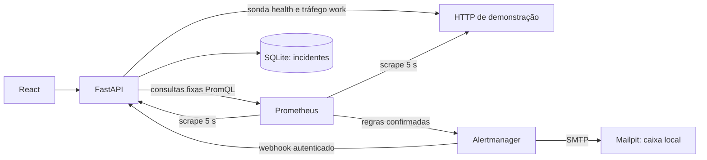

# Arquitetura e métricas

## Fluxo da etapa HTTP

O frontend compilado é servido pelo FastAPI, no mesmo host e porta. Apenas o backend acessa Prometheus a partir da interface. Consultas PromQL são fixas no código, sem entrada livre do navegador. O backend executa as sondas HTTP e PostgreSQL e a carga SQL em tarefas independentes.

## Componentes e dados

| Componente | Persistência | Responsabilidade |
|---|---|---|
| API | Volume incidents | Consultas, sonda, controles e recebimento de eventos |
| Serviço demo | Modo em memória | Respostas e métricas HTTP reais |
| Prometheus | Volume metrics, 7 dias | Séries temporais e avaliação de regras |
| Alertmanager | Volume alerts | Deduplicação, e-mail e webhook |
| Mailpit | Volume mail, até 200 mensagens | Recebimento local de SMTP |

SQLite persiste os incidentes independentemente do PostgreSQL monitorado. Nesta etapa, não migramos os eventos para o serviço em que provocamos falhas. O novo container SQL possui volume próprio, não expõe porta no host e habilita `pg_stat_statements`.

## Fluxo PostgreSQL

O monitor se conecta com `lab_monitor`, executa `SELECT 1` e lê as estatísticas SQL. O gerador conecta com `lab_workload` e altera somente uma tabela limitada a 1.000 registros. Ambos têm timeout e reconexão; não usam o papel administrador. O snapshot do coletor é exportado atomicamente no `/metrics` existente.

Prometheus armazena séries `postgres_*`; `/api/postgres` fornece o detalhe para o frontend. Falha SQL não é confundida com ausência de coleta: sonda concluída com erro é crítica, enquanto amostra com mais de 20 s é desconhecida. Estatísticas correntes são ocultadas quando o banco cai ou a coleta detalhada falha. A visão geral combina os estados dos dois serviços, sem deixar HTTP saudável esconder PostgreSQL indisponível.

O runbook PostgreSQL descreve os limites de cada métrica. QPS mede comandos do usuário de laboratório; commits e rollbacks são contadores globais do banco e incluem monitoramento. A latência SQL é conexão + SELECT 1, não p95. CPU, memória, disco e consultas lentas ainda não são coletados.

## Significado dos indicadores

| Indicador | Fonte | Observação |
|---|---|---|
| Estado HTTP | GET /health | 2xx significa sucesso; timeout/erro significa falha |
| Última coleta | probe_checked_at_seconds | Momento real da conclusão da sonda |
| Latência da sonda | probe_duration_seconds | Tempo de uma verificação, em ms na interface |
| Disponibilidade | avg_over_time(probe_success[período]) | Percentual sobre sondas existentes, não sobre o tempo anterior à instalação |
| RPS | rate(demo_http_requests_total[1m]) | Somente /work; exclui tráfego de health e métricas |
| Erros | rate(4xx + 5xx) / rate(total) | Percentual no último minuto; sem tráfego significa sem valor |
| p95 | histogram_quantile(0.95, rate(buckets[1m])) | Estimativa por histograma, não duração exata de cada requisição |

Taxas usam janela móvel de um minuto. O seletor 15m/1h/6h/24h define o intervalo exibido e o cálculo de disponibilidade. Histogramas preservam as falhas HTTP 503. O endpoint `/metrics` continua acessível nos modos de falha, permitindo distinguir um serviço HTTP com erro de um coletor indisponível.

## Estado observado e alerta confirmado

- OK: última sonda bem-sucedida, duração até 500 ms.
- Atenção: última sonda bem-sucedida acima de 500 ms.
- Crítico: última sonda falhou.
- Sem dados: ausência de resultado ou sonda com mais de 20 s, incluindo Prometheus indisponível.

Um estado pontual não é um incidente confirmado. As regras exigem 30 s de lentidão ou 15 s de falha, avaliadas a cada 5 s. A indisponibilidade da API/coletor também tem alerta próprio, emitido pelo Prometheus. E-mails desse alerta podem chegar enquanto o webhook aguarda a API voltar.

O webhook usa a chave composta `(fingerprint, startsAt)` para manter um evento por ocorrência. Resoluções são persistidas; uma notificação firing atrasada não reabre um evento resolvido. Os horários são armazenados em UTC e exibidos no fuso do navegador.

## Referências técnicas

- [Prometheus: visão geral](https://prometheus.io/docs/introduction/overview/)
- [HTTP API do Prometheus](https://prometheus.io/docs/prometheus/latest/querying/api/)
- [Configuração do Alertmanager](https://prometheus.io/docs/alerting/latest/configuration/)
- [Lifespan do FastAPI](https://fastapi.tiangolo.com/advanced/events/)
- [Redes no Docker Compose](https://docs.docker.com/compose/how-tos/networking/)
