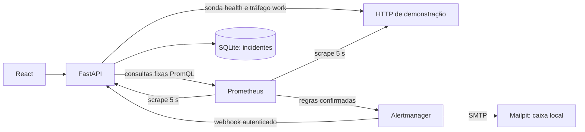

# Arquitetura e métricas

## Fluxo da etapa HTTP

O frontend compilado é servido pelo FastAPI, no mesmo host e porta. Apenas o backend acessa Prometheus a partir da interface. Consultas PromQL são fixas no código, sem entrada livre do navegador. O backend executa sondas HTTP, PostgreSQL, DNS e SMTP e seus geradores em tarefas independentes.

## Autenticação do painel

Login e sessões usam `security.sqlite` no volume de incidentes, independente dos quatro serviços monitorados. A configuração local gera uma senha e conserva seu hash scrypt em arquivo montado somente na API. Identificadores de sessão são aleatórios; SQLite guarda seu SHA-256, expiração e versão das credenciais. Cookie HttpOnly/SameSite e CSRF por sessão protegem o acesso e as mutações.

Middleware exige sessão nos dados e controles; health, métricas e webhook possuem acesso próprio. Uvicorn da API ignora proxy headers. O limitador reserva tentativas atomicamente em orçamento de 60 s separado do histórico: cinco falhas por IP ou dez por conta impedem novos logins até a janela liberar. O histórico é limitado a 10.000 eventos/7 dias; contadores persistentes e agregação dos bloqueios por segundo sobrevivem à limpeza.

Prometheus coleta `security_auth_attempts_total`, `security_auth_failures_recent` e `security_auth_blocked_recent` sem rótulos de identidade. O alerta `AutenticacaoSuspeita` confirma o limiar por 10 s e usa o mesmo canal de incidentes/e-mails. A interface Segurança lê eventos autenticados da API. A comparação de tráfego está descrita a seguir; autenticação dos serviços, arquivos e vulnerabilidades permanecem pendentes.

## Referência de tráfego

Uma tarefa independente consulta quatro expressões fixas no Prometheus para taxas de 1 min. Gates de sonda, fonte nativa, estatísticas SQL e atualidade impedem usar contadores antigos como tráfego atual. Referências são médias de pelo menos 25 amostras cobrindo 120 s contínuos, persistidas em `traffic.sqlite`; o snapshot em memória só é publicado após commit.

Referências prontas ficam fixas. Limiar por serviço é max(3× referência, piso). API e exportador diferenciam volume normal, acima do limiar, aprendizado e ausência de dados. Prometheus confirma aumentos por 30 s e envia incidentes/e-mails. O estado de fonte desconhecida tem regra própria; ausência de série de volume não comprova recuperação.

Um job temporário por vez gera protocolos locais com alvo fixo, limites de frequência/operações/duração e cancelamento. Sessão, CSRF e LAB_TOKEN protegem início, cancelamento e recalibração. Cancelar encerra tarefas irmãs e conexões; SMTP usa streams assíncronos. Referências persistem após reiniciar a API, enquanto o job é transitório. O [runbook de tráfego](runbook-trafego.md) descreve unidades e limites.

## Fluxo SMTP

`smtp:2525` é um servidor aiosmtpd com fila SQLite em volume `smtp-data`. DATA recebe confirmação somente após persistência. Um worker encaminha via smtplib para `smtp-inbox:1025`, com retry de falhas temporárias após 5 s. O receptor possui caixa web localhost:8026 e volume `smtp-mail`; o Mailpit original em 8025 permanece exclusivo para alertas.

A API mede EHLO + NOOP e gera mensagens reais a cada 15 s. Prometheus coleta fila, volumes, contadores persistentes e histograma aceitação → confirmação do receptor em `smtp:8027/metrics`. `/api/smtp` combina métricas com a sonda, ocultando dados antigos/indisponíveis; a visão geral reúne quatro serviços. Ausência do exportador não equivale a falha da conexão SMTP.

Aceitação, tentativa, entrega e rejeição são eventos distintos. A taxa acumulada de entrega divide mensagens confirmadas por aceitas. A entrega é local, sem correio externo, e pode repetir uma mensagem após queda na janela entre confirmação remota e commit local. O [runbook SMTP](runbook-smtp.md) define métricas, limites e demonstrações reproduzíveis.

## Fluxo DNS

CoreDNS hospeda `aularedes.test` em UDP/TCP 1053, apenas na rede Compose, sem substituir o resolvedor do host. A sonda dnspython consulta diretamente o IP do container, sem cache, e exige o registro A esperado pelos dois protocolos. A duração é a maior das duas consultas.

Sondas são exportadas no `/metrics` da API; Prometheus também coleta métricas nativas do CoreDNS na porta 9153 (`job=dns`). `/api/dns` combina as duas fontes: falha de resolução é crítica; ausência do exporter com resolução funcionando remove apenas as estatísticas detalhadas. Resultados antigos expiram em 20 s.

Consultas/s e p95 de processamento vêm do CoreDNS. NXDOMAIN é separado de SERVFAIL/REFUSED/FORMERR/NOTIMP. Há um registro SERVFAIL intencional para verificação; a carga periódica não o utiliza. A visão geral combina os quatro serviços, e incidentes DNS usam o mesmo webhook autenticado e armazenamento independente.

## Componentes e dados

| Componente | Persistência | Responsabilidade |
|---|---|---|
| API | Volume incidents | Consultas, sonda, controles e recebimento de eventos |
| Serviço demo | Modo em memória | Respostas e métricas HTTP reais |
| Prometheus | Volume metrics, 7 dias | Séries temporais e avaliação de regras |
| Alertmanager | Volume alerts | Deduplicação, e-mail e webhook |
| Mailpit | Volume mail, até 200 mensagens | Recebimento local de SMTP |

SQLite persiste os incidentes independentemente do PostgreSQL monitorado. Nesta etapa, não migramos os eventos para o serviço em que provocamos falhas. O novo container SQL possui volume próprio, não expõe porta no host e habilita `pg_stat_statements`.

## Fluxo PostgreSQL

O monitor se conecta com `lab_monitor`, executa `SELECT 1` e lê as estatísticas SQL. O gerador conecta com `lab_workload` e altera somente uma tabela limitada a 1.000 registros. Ambos têm timeout e reconexão; não usam o papel administrador. O snapshot do coletor é exportado atomicamente no `/metrics` existente.

Prometheus armazena séries `postgres_*`; `/api/postgres` fornece o detalhe para o frontend. Falha SQL não é confundida com ausência de coleta: sonda concluída com erro é crítica, enquanto amostra com mais de 20 s é desconhecida. Estatísticas correntes são ocultadas quando o banco cai ou a coleta detalhada falha. A visão geral combina os estados dos dois serviços, sem deixar HTTP saudável esconder PostgreSQL indisponível.

O runbook PostgreSQL descreve os limites de cada métrica. QPS mede comandos do usuário de laboratório; commits e rollbacks são contadores globais do banco e incluem monitoramento. A latência SQL é conexão + SELECT 1, não p95. CPU, memória, disco e consultas lentas ainda não são coletados.

## Significado dos indicadores

| Indicador | Fonte | Observação |
|---|---|---|
| Estado HTTP | GET /health | 2xx significa sucesso; timeout/erro significa falha |
| Última coleta | probe_checked_at_seconds | Momento real da conclusão da sonda |
| Latência da sonda | probe_duration_seconds | Tempo de uma verificação, em ms na interface |
| Disponibilidade | avg_over_time(probe_success[período]) | Percentual sobre sondas existentes, não sobre o tempo anterior à instalação |
| RPS | rate(demo_http_requests_total[1m]) | Somente /work; exclui tráfego de health e métricas |
| Erros | rate(4xx + 5xx) / rate(total) | Percentual no último minuto; sem tráfego significa sem valor |
| p95 | histogram_quantile(0.95, rate(buckets[1m])) | Estimativa por histograma, não duração exata de cada requisição |

Taxas usam janela móvel de um minuto. O seletor 15m/1h/6h/24h define o intervalo exibido e o cálculo de disponibilidade. Histogramas preservam as falhas HTTP 503. O endpoint `/metrics` continua acessível nos modos de falha, permitindo distinguir um serviço HTTP com erro de um coletor indisponível.

## Estado observado e alerta confirmado

- OK: última sonda bem-sucedida, duração até 500 ms.
- Atenção: última sonda bem-sucedida acima de 500 ms.
- Crítico: última sonda falhou.
- Sem dados: ausência de resultado ou sonda com mais de 20 s, incluindo Prometheus indisponível.

Um estado pontual não é um incidente confirmado. As regras exigem 30 s de lentidão ou 15 s de falha, avaliadas a cada 5 s. A indisponibilidade da API/coletor também tem alerta próprio, emitido pelo Prometheus. E-mails desse alerta podem chegar enquanto o webhook aguarda a API voltar.

O webhook usa a chave composta `(fingerprint, startsAt)` para manter um evento por ocorrência. Resoluções são persistidas; uma notificação firing atrasada não reabre um evento resolvido. Os horários são armazenados em UTC e exibidos no fuso do navegador.

## Referências técnicas

- [Prometheus: visão geral](https://prometheus.io/docs/introduction/overview/)
- [HTTP API do Prometheus](https://prometheus.io/docs/prometheus/latest/querying/api/)
- [Configuração do Alertmanager](https://prometheus.io/docs/alerting/latest/configuration/)
- [Lifespan do FastAPI](https://fastapi.tiangolo.com/advanced/events/)
- [Redes no Docker Compose](https://docs.docker.com/compose/how-tos/networking/)
