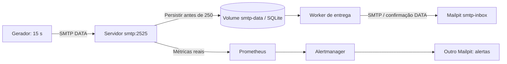

# SMTP: fila, entrega e recuperação

## Componentes

O servidor monitorado é um MTA de laboratório em Python/aiosmtpd, implementado neste projeto. A proposta inicial de Postfix foi substituída por essa implementação para tornar fila, persistência e confirmação de entrega observáveis diretamente. Não é uma instalação de Postfix nem um serviço de correio de produção.

| Componente | Endereço | Função |
|---|---|---|
| SMTP monitorado | smtp:2525, interno | Aceita e persiste mensagens |
| Exportador | smtp:8027/metrics, interno | Fila e contadores persistentes |
| Receptor de mensagens | smtp-inbox:1025, interno | Confirma entrega local |
| Caixa SMTP | http://localhost:8026 | Visualizar as mensagens entregues |
| Canal de alertas | mailpit:1025 / http://localhost:8025 | Receber alertas, independentemente do SMTP monitorado |

O painel fica em http://localhost:8000/#smtp. As portas SMTP não são publicadas no host. O servidor aceita somente `aluno@aularedes.test`, um destinatário por transação, mensagens de até 64 KiB e até 1.000 mensagens pendentes. Outros destinatários recebem 550; falta de espaço/capacidade retorna 452 para permitir nova tentativa pelo cliente.

## Caminho e significado das métricas



- **Sonda:** EHLO + NOOP a cada ciclo de 5 s, com timeout por operação. Não envia mensagens. Disponibilidade é o percentual das sondas existentes no período selecionado.
- **Aceitas:** DATA confirmado com 250 após commit SQLite. O gerador usa mensagens reais, com Message-ID único, aproximadamente quatro por minuto.
- **Entregues:** o receptor local confirmou DATA. Não mede leitura ou recebimento em provedor externo. O conteúdo é removido da fila após confirmação; metadados e contadores permanecem.
- **Fila:** mensagens pendentes ou em trânsito, ainda sem confirmação persistida. Continua aceitando enquanto o receptor está parado, até o limite de capacidade.
- **Entrega percentual:** total entregue / total aceito desde o início do volume. Não depende do período selecionado dos gráficos. Sem nenhuma mensagem aceita, aparece sem valor.
- **Volume minuto/hora:** contagem exata de aceitas nos últimos 60/3.600 s; gráfico usa `rate(aceitas[1m])*60`. O seletor define o histórico exibido.
- **Tempo de entrega p95:** estimativa por histograma das entregas confirmadas na janela de 1 min, incluindo espera na fila. Uma fila ainda sem entrega não produz latência de entrega. Se todas excederem 300 s, o histograma retorna o maior limite finito como estimativa.
- **Tentativas com falha:** inclui erros temporários e definitivos nas tentativas de encaminhamento; gráfico atual em tentativas/min. Uma mesma mensagem pode ter várias tentativas.
- **Falhas definitivas:** mensagens cujo encaminhamento recebeu 5xx. Saem da fila como falhas, sem incrementar entregues. Este laboratório não implementa mensagens automáticas de devolução (DSN).
- **Rejeitados:** comandos RCPT recusados, inclusive segundo destinatário; não são mensagens aceitas nem falhas de entrega.

Retentativas temporárias ocorrem após 5 s. Erros transitórios no SQLite são repetidos sem reenviar uma mensagem já confirmada pelo receptor enquanto o processo permanece ativo. Reiniciar recupera mensagens em trânsito: a garantia é de entrega **pelo menos uma vez**, e uma queda entre confirmação remota e commit local pode gerar duplicata. A aceitação não garante prazo máximo de entrega; pendências permanecem para nova tentativa.

O SQLite usa volume próprio, separado dos incidentes e do PostgreSQL monitorado. Não remova volumes para demonstrar falhas. Metadados SMTP não têm expiração automática nesta etapa; o Mailpit mantém as 200 mensagens mais recentes, e o Prometheus retém 7 dias.

## Demonstração de fila

```powershell
docker compose stop smtp-inbox
```

Observe a fila crescer com o tráfego automático. Cinco pendências requerem cerca de 75 s a partir de uma fila vazia. O painel sinaliza atenção assim que observa fila ≥5; o alerta `SMTPFilaElevada` exige 30 s contínuos nessa condição, além dos intervalos de coleta/avaliação. O alerta chega à caixa **8025**.

```powershell
docker compose start smtp-inbox
```

O worker entrega as pendências à caixa **8026**. A fila cai para zero, o incidente resolve e o Alertmanager envia a recuperação à caixa 8025.

## Demonstração de indisponibilidade

```powershell
docker compose stop smtp
```

Após 15 s de falha observada em EHLO/NOOP, `SMTPIndisponivel` gera incidente crítico e e-mail. Estatísticas antigas ficam ocultas. HTTP, SQL, DNS e o canal de alerta permanecem disponíveis.

```powershell
docker compose start smtp
```

As sondas e o encaminhamento retomam; contadores e pendências sobrevivem. O incidente é resolvido automaticamente. Para lentidão, `SMTPLento` exige sonda >500 ms por 30 s; exportador inacessível com SMTP respondendo gera `SMTPEstatisticasIndisponiveis` após 30 s.

## Verificação automatizada

```powershell
.\.venv\Scripts\python.exe scripts/verify_smtp.py
```

O roteiro envia mensagens internas, compara Message-ID na caixa receptora, rejeita destinatário inválido, provoca fila, reinicia o MTA com pendências, recupera o receptor, interrompe o SMTP e confirma incidentes/e-mails de abertura e recuperação. Sempre inicia ambos os serviços no `finally`. O relatório sem credenciais fica em `tmp/smtp-e2e-result.json`.

## Limites de ambiente

SMTP sem autenticação/TLS apenas para laboratório na rede Docker, sem encaminhamento externo. Não há entrega por MX público, antispam, DKIM, SPF, DMARC, DSN ou administração de caixas reais. A fase de segurança e o relatório final devem tratar esses limites explicitamente.
